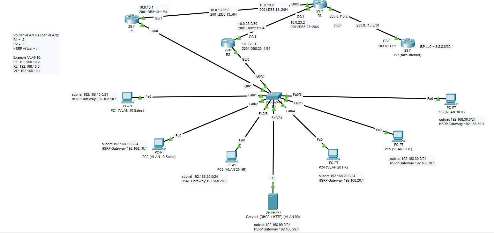

# CCNA Enterprise Mega Lab

**Enterprise Network Design, Configuration & Troubleshooting | Cisco Packet Tracer**


## Project Overview

This project demonstrates a simulated enterprise network designed, configured, and tested using **Cisco Packet Tracer**. It integrates multiple CCNA technologies into a single environment, including routing, switching, gateway redundancy, network services, security, IPv6, and simulated Internet access.

The objective is to develop practical skills in **enterprise network configuration, verification, fault isolation, and troubleshooting**.

## Network Topology



*Enterprise network topology developed in Cisco Packet Tracer.*

## Technologies Implemented

| Category | Technologies |
|---|---|
| Switching | VLANs, 802.1Q Trunking |
| Inter-VLAN Connectivity | Router-on-a-Stick |
| High Availability | HSRP |
| Dynamic Routing | OSPFv2, OSPFv3 |
| IPv4 / IPv6 | Dual-Stack Networking |
| Network Services | DHCP, DHCP Relay |
| Internet Connectivity | NAT Overload (PAT) |
| Network Security | IPv4 ACLs, IPv6 ACLs |
| Troubleshooting | Cisco IOS CLI, Routing Tables, Connectivity Tests |

## Network Devices

### Routers
- R1
- R2
- R3
- ISP

### Switches
- S1

### End Devices
- PC1–PC6
- Server1

## VLAN Design

| VLAN | Name | IPv4 Network |
|---|---|---|
| 10 | SALES | 192.168.10.0/24 |
| 20 | HR | 192.168.20.0/24 |
| 30 | IT | 192.168.30.0/24 |
| 99 | SERVERS | 192.168.99.0/24 |

VLANs provide logical segmentation of departments and services. Inter-VLAN communication is implemented using router-on-a-stick.

## IPv6 Design

| VLAN | IPv6 Prefix |
|---|---|
| 10 | 2001:DB8:10::/64 |
| 20 | 2001:DB8:20::/64 |
| 30 | 2001:DB8:30::/64 |
| 99 | 2001:DB8:99::/64 |

IPv6 addressing and OSPFv3 are implemented to support dynamic IPv6 connectivity.

## High Availability — HSRP

HSRP is implemented between **R1 and R2** to provide redundant default gateways for the VLANs.

### Virtual Gateway Addresses

| VLAN | Virtual Gateway |
|---|---|
| 10 | 192.168.10.1 |
| 20 | 192.168.20.1 |
| 30 | 192.168.30.1 |
| 99 | 192.168.99.1 |

### HSRP Active Router Distribution

| VLAN | Active Router |
|---|---|
| 10 | R1 |
| 20 | R2 |
| 30 | R2 |
| 99 | R1 |

This design distributes active gateway responsibilities across both routers while providing gateway redundancy.

**Verification Command:**

```bash
show standby brief
```

## Dynamic Routing

### OSPFv2 — IPv4

OSPFv2 is configured between **R1, R2, and R3**.

**Objectives:**
- Enable automatic IPv4 route exchange.
- Provide dynamic routing between network segments.
- Support route recalculation following network changes.

**Verification Commands:**

```bash
show ip ospf neighbor
show ip route
show ip protocols
```

### OSPFv3 — IPv6

OSPFv3 is implemented for dynamic IPv6 routing.

**Objectives:**
- Exchange IPv6 routes between routers.
- Establish IPv6 end-to-end connectivity.
- Verify IPv6 routing and neighbor relationships.

**Verification Commands:**

```bash
show ipv6 ospf neighbor
show ipv6 route
```

## DHCP Services and Relay

**Server1** provides centralized DHCP services for the VLANs.

DHCP relay is implemented using the Cisco IOS `ip helper-address` command to forward DHCP requests across routed interfaces.

**Objectives:**
- Centralize DHCP services.
- Assign IPv4 addresses automatically.
- Support clients across multiple VLANs.

**Verification Commands:**

```bash
show ip interface
show ip dhcp binding
```

*DHCP bindings can be inspected on a Cisco IOS DHCP server, where applicable. Server1 lease details are verified using its DHCP service interface and client addressing.*

## NAT Overload (PAT)

NAT Overload is configured on **R3** to allow internal private IPv4 networks to communicate with the simulated external network.

**NAT Configuration Details:**

| Parameter | Value |
|---|---|
| NAT Router | R3 |
| Translation Method | PAT |
| Public Interface Address | 203.0.113.2 |
| External Test Destination | 8.8.8.8 |

**Verification Commands:**

```bash
show ip nat translations
show ip nat statistics
```

The external IP addresses are used within the simulated lab environment.

## Network Security

### IPv4 Access Control Lists

An IPv4 ACL restricts HTTP traffic from **VLAN 20 (HR)** to the internal server while allowing other permitted traffic.

**Objective:** Demonstrate selective Layer 3/Layer 4 traffic filtering.

### IPv6 Access Control Lists

An IPv6 ACL restricts traffic originating from **VLAN 30 (IT)** while permitting necessary ICMPv6 traffic.

**Objective:** Demonstrate IPv6 traffic filtering without disrupting essential IPv6 network functions.

**Verification Commands:**

```bash
show access-lists
show ipv6 access-list
```

## Network Verification

The following commands are used to inspect operational state and validate network connectivity.

| Technology | Verification Commands |
|---|---|
| VLANs | `show vlan brief` |
| Trunking | `show interfaces trunk` |
| HSRP | `show standby brief` |
| OSPFv2 | `show ip ospf neighbor` |
| IPv4 Routing | `show ip route` |
| OSPFv3 | `show ipv6 ospf neighbor` |
| IPv6 Routing | `show ipv6 route` |
| NAT/PAT | `show ip nat translations` |
| IPv4 ACL | `show access-lists` |
| IPv6 ACL | `show ipv6 access-list` |

## Validation Performed

### Layer 2
- Verified VLAN connectivity.
- Verified 802.1Q trunk operation.

### Layer 3
- Verified inter-VLAN communication.
- Verified OSPFv2 route exchange.
- Verified OSPFv3 route exchange.

### High Availability
- Tested HSRP gateway redundancy.
- Verified HSRP failover operation.

### Network Services
- Verified DHCP address assignment.
- Verified DHCP relay between VLANs.

### Network Security
- Tested IPv4 ACL traffic restrictions.
- Tested IPv6 ACL traffic restrictions.

### Internet Connectivity
- Verified PAT translations.
- Tested connectivity to the simulated external destination `8.8.8.8`.

## Troubleshooting Scenarios

The lab includes troubleshooting exercises involving:

| Scenario | Investigation Areas |
|---|---|
| DHCP Failure | Server configuration, VLAN connectivity, DHCP relay |
| Missing Helper Address | Router interface settings, DHCP forwarding |
| OSPF Adjacency Issues | Neighbor state, interface configuration, OSPF settings |
| NAT Translation Issues | NAT rules, interfaces, routing, ACL matches |
| ACL Connectivity Problems | ACL entries, rule order, interface application |
| HSRP Failover | Active/standby state, priority, interface availability |
| IPv6 Routing Problems | IPv6 addressing, OSPFv3, IPv6 routing tables |

### Troubleshooting Methodology

1. **Identify:** Determine affected clients, networks, or services.
2. **Isolate:** Examine interfaces, addressing, VLANs, and routing.
3. **Diagnose:** Review Cisco IOS configurations and command outputs.
4. **Resolve:** Correct the identified configuration issue.
5. **Verify:** Re-test network connectivity and operational state.
6. **Document:** Record findings and corrective actions.

## Skills Demonstrated

- Cisco Router and Switch Configuration
- Enterprise VLAN Segmentation
- Inter-VLAN Routing
- HSRP Gateway Redundancy
- Dynamic Routing with OSPFv2 and OSPFv3
- DHCP Services and DHCP Relay
- NAT Overload (PAT)
- IPv4 and IPv6 Access Control Lists
- Dual-Stack Network Design
- Cisco IOS Verification Commands
- Network Fault Isolation and Troubleshooting

## Project Outcome

Successfully designed, configured, verified, and troubleshot a simulated enterprise network using Cisco Packet Tracer.

This project demonstrates practical CCNA-level knowledge of routing, switching, network services, redundancy, access control, IPv6, and structured network troubleshooting.

---

**Author:** [Amir Samandi](https://github.com/asamandi)  
**LinkedIn:** [linkedin.com/in/amir-samandi](https://linkedin.com/in/amir-samandi)  
**Platform:** Cisco Packet Tracer  
**Project Type:** Enterprise Networking Home Lab
